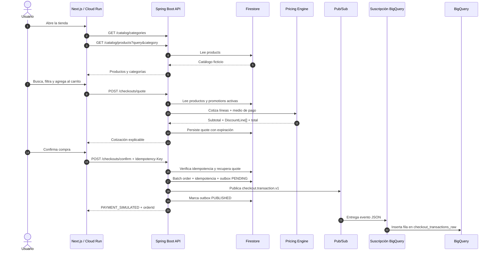

# Arquitectura y flujo — Walmart Retail Checkout

## 1. Objetivo

La solución demuestra un flujo retail completo: explorar un catálogo, buscar y
filtrar por categoría, armar un carrito, calcular promociones explicables,
seleccionar el medio de pago, confirmar una compra ficticia y proyectar la
transacción hacia BigQuery mediante Pub/Sub.

El foco está en separar la lógica de precios de la infraestructura para poder
incorporar promociones y medios de pago sin modificar controladores ni la UI.

## 2. Vista de componentes


El SVG está diseñado de arriba hacia abajo para verse con claridad durante una
presentación: navegador → frontend → API/motor → datos/eventos → analítica.

| Componente | Lenguaje / tecnología | Responsabilidad | Ubicación desplegada | Ubicación local |
|---|---|---|---|---|
| Checkout web | TypeScript, React 19, Next.js 15, CSS | Rutas separadas para catálogo, carrito, pago y confirmación | Cloud Run `retail-checkout-web` | Node.js, puerto 3000 |
| Checkout API | Java 21, Spring Boot 3, Gradle | REST, validación, CORS, Swagger, idempotencia y orquestación | Cloud Run `retail-checkout-api` | JVM, puerto 8080 |
| Pricing Engine | Java puro, Strategy | Aplica reglas ordenadas y produce líneas de descuento explicables | Dentro de la API | Dentro de la API |
| Repositorio operacional | Firestore + Java SDK | Productos, promociones, cotizaciones, órdenes e idempotencia | Firestore `(default)` | El mismo Firestore real |
| Bus de eventos | Google Pub/Sub | Desacopla checkout de analítica con `checkout.transaction.v1` | Tópico administrado | El mismo tópico real |
| Proyección | Suscripción Pub/Sub para BigQuery | Valida el payload y escribe cada evento | `checkout-analytics-bigquery` | El mismo servicio real |
| Almacén analítico | BigQuery Standard SQL | Tabla cruda, partición temporal y vista deduplicada | Dataset `retail_analytics` | El mismo BigQuery real |
| Infraestructura | Terraform Google provider | APIs, IAM, Firestore, Pub/Sub, BigQuery, Artifact Registry y Cloud Run | Estado remoto GCS | CLI local contra GCP |

No hay emuladores. En ejecución local solamente cambian los procesos de web y
API; Firestore, Pub/Sub y BigQuery siguen siendo servicios reales del proyecto
`walmart-demo-511500` mediante Application Default Credentials.

## 3. Flujo principal

### 3.1 Navegación del usuario

```text
/                 Página principal: catálogo, categorías, búsqueda y selección
        ↓
/carrito          Cantidades, eliminación, ofertas y promociones de carrito
        ↓
/checkout         Medio de pago, descuento adicional, total final y confirmación
```

El carrito se guarda en `localStorage` y se sincroniza con el contador del
encabezado. El frontend nunca calcula promociones: cada página solicita una
nueva cotización a la API. En `/carrito` se usa transferencia como base neutra;
en `/checkout` se recotiza al seleccionar débito, crédito o transferencia.

### 3.2 Secuencia técnica



## 4. Catálogo y colecciones Firestore

La API inicializa datos ficticios con escrituras idempotentes. Las colecciones
se mantienen separadas por responsabilidad:

```text
products/{productId}
  name, category, unitPrice, productDiscountPercent

promotions/{promotionCode}
  name, type, percent, minimumAmount, maxDiscount,
  paymentMethod, priority, active

quotes/{quoteId}
  paymentMethod, subtotal, discounts[], total, expiresAt, lines[]

orders/{orderId}
  status, confirmedAt, quote snapshot

idempotency-keys/{key}
  orderId

outbox-events/{orderId}
  orderId, status, createdAt, publishedAt
```

Actualmente se cargan 12 productos en Tecnología, Hogar, Despensa,
Electrodomésticos y Deportes. Las categorías no están duplicadas en Next.js:
se calculan desde los documentos de producto mediante
`GET /api/v1/catalog/categories`.

## 5. Motor de precios

`PricingEngine` recibe una lista ordenada de estrategias `PromotionRule`.
`ProductDiscountRule` cubre las ofertas incluidas en cada producto y
`ConfiguredPromotionRule` adapta documentos activos de Firestore.

Orden de aplicación:

1. subtotal bruto: precio unitario × cantidad;
2. descuento de productos;
3. promoción de carrito sobre el total vigente;
4. promoción del medio de pago sobre el total vigente;
5. envío;
6. total final nunca menor que cero.

Cada regla devuelve una `DiscountLine` con código, nombre, tipo, monto, base de
cálculo, prioridad y combinabilidad. Así la UI no intenta reproducir reglas:
sólo presenta el desglose autoritativo de la API.

Promociones ficticias iniciales:

| Código | Tipo | Regla |
|---|---|---|
| `CART_5_OVER_200K` | `CART_THRESHOLD` | 5% después de ofertas si el total vigente supera $200.000 |
| `DEBIT_10` | `PAYMENT_METHOD` | 10% con débito, tope $50.000 |

## 6. Contrato REST y Swagger

| Método | Ruta | Responsabilidad |
|---|---|---|
| `GET` | `/api/v1/catalog/categories` | Categorías únicas de Firestore |
| `GET` | `/api/v1/catalog/products?query=&category=` | Catálogo, búsqueda y filtro |
| `GET` | `/api/v1/payment-methods` | Medios de pago soportados |
| `POST` | `/api/v1/checkouts/quote` | Cotización sin crear orden |
| `POST` | `/api/v1/checkouts/confirm` | Pago ficticio, persistencia y evento |
| `GET` | `/api/v1/orders/{orderId}` | Recuperación de orden |
| `GET` | `/swagger-ui/index.html` | Documentación interactiva |

La confirmación exige `Idempotency-Key`. Si se repite la misma clave, devuelve
la orden original y no vuelve a publicar el evento.

## 7. Evento y BigQuery

La API publica después de persistir en un mismo batch la orden, idempotencia y
outbox, y espera la confirmación de Pub/Sub antes de responder. Si la
publicación falla, el outbox queda `PENDING` y el reintento con la misma clave
publica el mismo `eventId`. El contrato no contiene datos personales:

```json
{
  "eventId": "evt_...",
  "eventType": "checkout.transaction.v1",
  "occurredAt": "2026-10-13T04:28:01.010518551Z",
  "orderId": "ord_...",
  "subtotal": 309980,
  "productDiscount": 48897,
  "cartDiscount": 13054,
  "paymentDiscount": 24803,
  "finalTotal": 223226,
  "paymentMethod": "DEBIT",
  "promotionCodes": ["PRODUCT_OFFER", "CART_5_OVER_200K", "DEBIT_10"],
  "schemaVersion": 1
}
```

`occurredAt` usa RFC 3339 para ser compatible con la columna `TIMESTAMP`. La
suscripción `checkout-analytics-bigquery` usa el esquema de la tabla y escribe
en:

```text
walmart-demo-511500.retail_analytics.checkout_transactions_raw
```

La tabla está particionada por `occurredAt` y agrupada por `paymentMethod` y
`orderId`. La vista `checkout_transactions` usa `ROW_NUMBER()` por `eventId`
para tolerar reentregas de Pub/Sub.

## 8. Infraestructura e IAM

Terraform administra:

- APIs requeridas;
- Artifact Registry `retail-checkout`;
- cuenta de servicio `retail-checkout-api`;
- Firestore Native con protección contra eliminación;
- tópico y suscripciones Pub/Sub;
- dataset, tabla y vista BigQuery con protección contra eliminación;
- permisos BigQuery del service agent de Pub/Sub;
- dos servicios Cloud Run públicos para la demo;
- invocación pública sin autenticación, explícita por alcance del ejercicio.

Permisos runtime de la API:

- `roles/datastore.user`;
- `roles/pubsub.publisher`.

El estado se guarda fuera del repositorio:

```text
gs://walmart-demo-511500-retail-checkout-tfstate/retail-checkout/demo
```

Los Makefiles siempre suministran ambas imágenes al aplicar Terraform, incluso
si sólo cambia un componente. Esto evita destruir accidentalmente el otro
servicio debido a los `count` condicionados por imagen.

## 9. Escalabilidad y costo

- Cloud Run: mínimo cero, máximo una instancia en esta demo.
- Firestore: lecturas simples; el filtro del catálogo se ejecuta sobre un
  conjunto ficticio pequeño para evitar índices compuestos innecesarios.
- Pub/Sub: retención de un día para las suscripciones de demo.
- BigQuery: expiración de 60 días para datos de la tabla, partición y consultas
  pequeñas.
- Sin balanceadores, VPC, GKE, bases SQL ni proveedor de pago.

Estas decisiones minimizan consumo, pero no prometen costo absoluto cero si se
exceden cuotas gratuitas o el proyecto tiene facturación habilitada.

## 10. Pruebas y evidencia de funcionamiento

### Automatizadas

- unitarias del orden y cálculo de promociones;
- integración de servicio para idempotencia y publicación única;
- integración HTTP MockMvc para cotización, búsqueda y categorías;
- serialización RFC 3339 del evento para BigQuery;
- compilación y type checking de Next.js;
- validación del grafo Terraform;
- smoke test con Chrome headless sobre la URL pública.

El smoke test acciona el menú y los filtros reales y comprueba:

- marca Walmart;
- menú lateral abierto;
- cinco categorías y opción Todos;
- 12 tarjetas de producto;
- cuatro resultados de Tecnología;
- búsqueda `café` → `Pack café premium`.
- navegación real `/` → `/carrito` → `/checkout`;
- persistencia del producto entre páginas;
- selección de medio de pago y confirmación desde el frontend.

### Última validación end-to-end

Orden de prueba desplegada:

```text
orderId:          ord_9b9eeb72-fd78-43ef-8f29-90f3b0383aa4
subtotal:         299990
productDiscount: 44999
cartDiscount:    12750
paymentDiscount: 24224
finalTotal:       218017
paymentMethod:    DEBIT
outbox:           PUBLISHED
rawDeliveries:    1
```

La misma orden fue verificada en Firestore a través de la respuesta de
confirmación, publicada en Pub/Sub y consultada finalmente en BigQuery.

## 11. Trade-offs y evolución

| Decisión | Beneficio | Trade-off / evolución |
|---|---|---|
| Monolito modular | Menos despliegues y dominio claro | Separar módulos sólo cuando exista necesidad de escalado independiente |
| Reglas desde Firestore | Campañas configurables sin redespliegue para tipos existentes | Un tipo de promoción nuevo todavía requiere implementar una Strategy |
| Batch de orden + idempotencia + outbox | Permite recuperar una publicación fallida sin duplicar la compra | Un scheduler de outbox sería necesario para recuperar sin reintento del cliente |
| Publicación síncrona | La respuesta confirma que Pub/Sub aceptó el evento | Agrega latencia; un relay asíncrono sería la evolución productiva |
| Pub/Sub → BigQuery administrado | Sin consumidor propio ni credenciales BigQuery en la API | Consistencia eventual y contrato JSON estricto |
| Filtro Firestore en memoria | Demo simple sin índices adicionales | En catálogo grande usar búsqueda indexada o un motor especializado |
| Sin autenticación | Evaluador levanta y prueba sin configuración adicional | Nunca apropiado para un checkout real |
