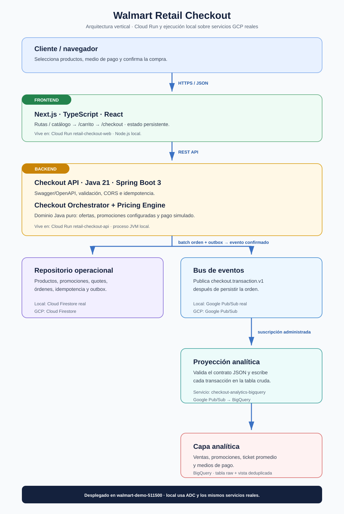
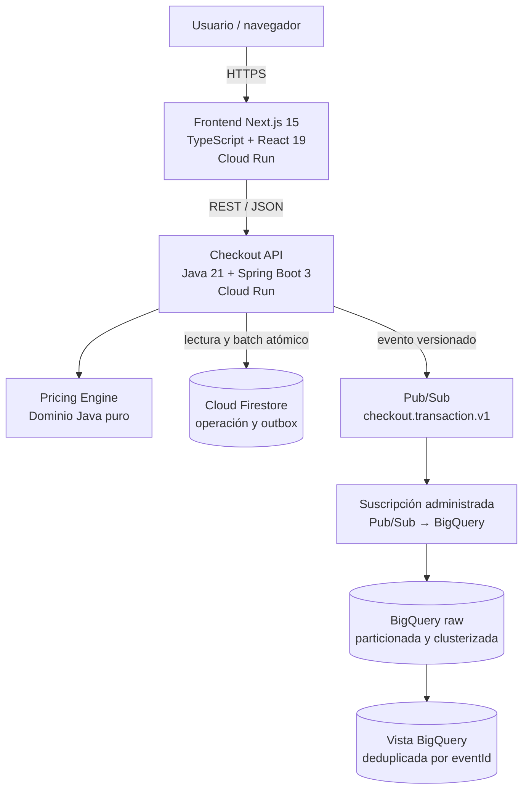
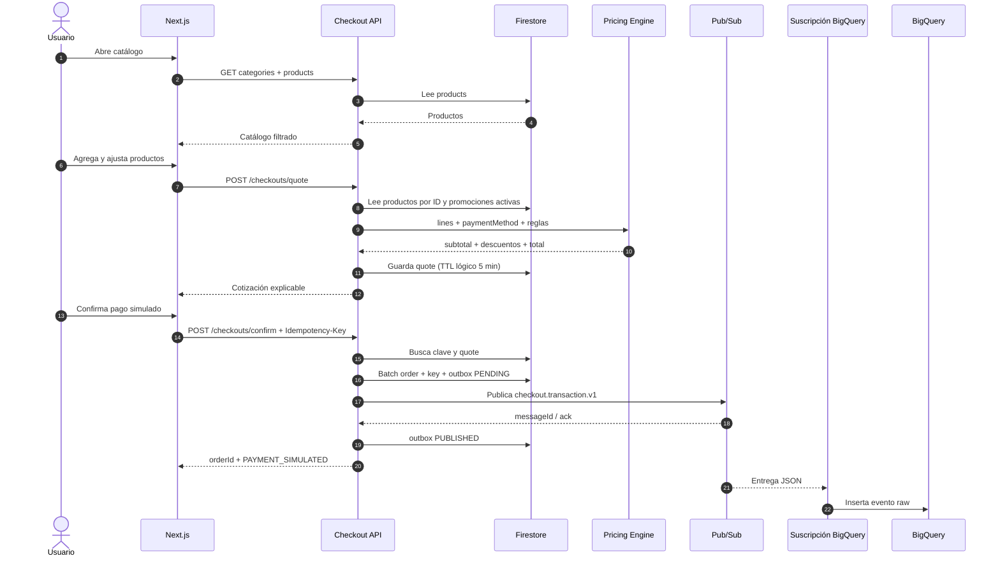

# Walmart Retail Checkout Demo

Solución funcional de checkout retail con un flujo completo de compra:
catálogo, búsqueda, categorías, carrito, promociones, selección del medio de
pago, confirmación simulada y proyección analítica en BigQuery.

El objetivo de esta demo no es procesar un pago real. El foco está en la lógica
de negocio, la trazabilidad del cálculo, la idempotencia y una arquitectura que
permita incorporar promociones o consumidores de eventos sin acoplarlos a la
interfaz web.

## Índice

- [Demo desplegada](#demo-desplegada)
- [Alcance funcional](#alcance-funcional)
- [Arquitectura](#arquitectura)
- [Estructura del repositorio](#estructura-del-repositorio)
- [Flujo completo de punta a punta](#flujo-completo-de-punta-a-punta)
- [Motor de precios y promociones](#motor-de-precios-y-promociones)
- [Persistencia en Firestore](#persistencia-en-firestore)
- [Eventos, outbox y BigQuery](#eventos-outbox-y-bigquery)
- [API REST y Swagger](#api-rest-y-swagger)
- [Ejecución local con servicios GCP reales](#ejecución-local-con-servicios-gcp-reales)
- [Infraestructura con Terraform](#infraestructura-con-terraform)
- [Build y despliegue](#build-y-despliegue)
- [Pruebas](#pruebas)
- [Guion sugerido para la demo](#guion-sugerido-para-la-demo)
- [Decisiones, trade-offs y evolución](#decisiones-trade-offs-y-evolución)
- [Costos y limpieza](#costos-y-limpieza)
- [Solución de problemas](#solución-de-problemas)

## Demo desplegada

| Recurso | URL / identificador |
|---|---|
| Tienda | <https://retail-checkout-web-iva4iqx3eq-tl.a.run.app/> |
| Carrito | <https://retail-checkout-web-iva4iqx3eq-tl.a.run.app/carrito> |
| Pago | <https://retail-checkout-web-iva4iqx3eq-tl.a.run.app/checkout> |
| API | <https://retail-checkout-api-iva4iqx3eq-tl.a.run.app> |
| Swagger UI | <https://retail-checkout-api-iva4iqx3eq-tl.a.run.app/swagger-ui/index.html> |
| OpenAPI JSON | <https://retail-checkout-api-iva4iqx3eq-tl.a.run.app/v3/api-docs> |
| Proyecto GCP | `walmart-demo-511500` |
| Región de aplicación | `southamerica-west1` |

La aplicación es pública y no tiene autenticación porque ése es el alcance del
ejercicio. Todos los productos, órdenes y transacciones son ficticios.

## Alcance funcional

La implementación incluye:

- 12 productos de demostración almacenados en Firestore;
- cinco categorías obtenidas dinámicamente desde los productos;
- búsqueda por nombre o categoría y filtro por categoría;
- carrito persistente entre páginas y recargas del mismo navegador;
- cambio de cantidades y eliminación de productos;
- cotización autoritativa en el backend;
- descuentos individuales de producto;
- promoción por monto del carrito;
- promoción por medio de pago, con tope configurable;
- desglose de subtotal, descuentos, envío y total;
- cotizaciones con vigencia de cinco minutos;
- confirmación idempotente y pago simulado;
- orden y snapshot de la cotización persistidos en Firestore;
- publicación de un evento de negocio versionado en Pub/Sub;
- carga administrada desde Pub/Sub a BigQuery;
- tabla de eventos crudos y vista deduplicada;
- Swagger/OpenAPI, pruebas Java, chequeo TypeScript y smoke test de navegador;
- infraestructura reproducible con Terraform y estado remoto en Cloud Storage.

No incluye autenticación, inventario, reserva de stock, direcciones, cálculo
real de despacho, impuestos, integración bancaria ni devolución de pagos.

## Arquitectura

### Vista vertical de componentes



El diagrama está dispuesto de arriba hacia abajo para facilitar su lectura en
una presentación. La misma arquitectura puede expresarse así:



### Componentes, tecnología y ubicación

| Componente | Lenguaje / tecnología | Responsabilidad | Dónde vive desplegado | Dónde vive en local |
|---|---|---|---|---|
| Web retail | TypeScript 5.7, React 19, Next.js 15, CSS | Catálogo, carrito, pago y confirmación | Cloud Run `retail-checkout-web` | Node.js, puerto `3000` |
| Checkout API | Java 21, Spring Boot 3.4, Gradle 8.12 | REST, validación, CORS y orquestación | Cloud Run `retail-checkout-api` | JVM, puerto `8080` |
| OpenAPI | springdoc-openapi 2.8.14 | Contrato y consola Swagger | Dentro de la API | Dentro de la API |
| Motor de precios | Java puro, Strategy | Ordena y aplica reglas de descuento | Dentro de la API | Dentro de la API |
| Persistencia operacional | Firestore Native, Google Cloud Java SDK | Catálogo, promociones, quotes, órdenes, idempotencia y outbox | Firestore `(default)` | El mismo Firestore real |
| Bus de eventos | Google Pub/Sub | Desacopla checkout de analítica | Tópico `checkout.transaction.v1` | El mismo Pub/Sub real |
| Proyección productiva | Suscripción BigQuery de Pub/Sub | Escribe el JSON directamente en la tabla raw | `checkout-analytics-bigquery` | Servicio administrado GCP |
| Consumidor alternativo | Java, Pub/Sub Subscriber, BigQuery load job | Procesamiento batch demostrativo | Desactivado en Cloud Run | Opcional con `make backend-run-analytics` |
| Analítica | BigQuery Standard SQL | Eventos crudos y vista deduplicada | Dataset `retail_analytics` | El mismo BigQuery real |
| Imágenes | Docker, Cloud Build, Artifact Registry | Builds reproducibles y almacenamiento OCI | Repositorio `retail-checkout` | Docker sólo durante build |
| Infraestructura | Terraform Google Provider 6.x | GCP, IAM, Cloud Run y backend remoto | Recursos GCP | CLI local contra GCP |

`springdoc-openapi` se mantiene en 2.8.14 porque es la versión más reciente
validada con el Spring Boot 3.4.2 de este proyecto. Las versiones 2.8.17 y
2.9.1 fueron probadas y fallan al inicializar el parser de rutas MVC; la línea
3.x requiere migrar primero a Spring Boot 4.

### Capas del backend

```text
api/
  Controladores REST, DTO de salida, validación, CORS y OpenAPI
       │
application/
  Casos de uso CheckoutService y puertos CheckoutRepository /
  CheckoutEventPublisher
       │
domain/
  Product, CartLine, Quote, DiscountLine, PromotionRule, PricingEngine
       │
infrastructure/gcp/
  Adaptadores Firestore, Pub/Sub y BigQuery
```

El dominio no importa Spring ni clases de Google Cloud. La aplicación depende
de interfaces y los adaptadores resuelven los detalles externos. Así, el motor
puede probarse sin red y una tecnología de persistencia distinta puede
implementarse detrás de `CheckoutRepository`.

`CatalogController` consulta el puerto de repositorio directamente porque el
catálogo de esta demo es de sólo lectura. En una aplicación mayor convendría
darle un caso de uso propio para mantener la misma separación que checkout.

### Seguridad e identidades

- Los dos servicios Cloud Run permiten invocación anónima deliberadamente.
- La API usa la cuenta dedicada `retail-checkout-api`, no la cuenta por defecto.
- Esa cuenta recibe únicamente `roles/datastore.user` y
  `roles/pubsub.publisher`.
- La API no tiene permisos para escribir en BigQuery.
- El service agent de Pub/Sub recibe `roles/bigquery.dataEditor` sobre el
  dataset y `roles/bigquery.metadataViewer` sobre el proyecto.
- No hay llaves JSON, secretos ni datos de pago en el repositorio.
- En local se usan Application Default Credentials (ADC) del usuario.

## Estructura del repositorio

```text
.
├── backend/
│   ├── src/main/java/cl/retail/checkout/
│   │   ├── api/                 # REST, errores, CORS y Swagger
│   │   ├── application/         # casos de uso y puertos
│   │   ├── domain/              # modelo y reglas de precio
│   │   └── infrastructure/      # adaptadores GCP y dobles en memoria
│   ├── src/test/                # pruebas unitarias e integración
│   ├── build.gradle.kts
│   ├── Dockerfile
│   └── Makefile
├── frontend/
│   ├── src/app/                 # rutas /, /carrito y /checkout
│   ├── src/components/          # páginas y componentes visuales
│   ├── src/hooks/useCart.ts     # estado persistente del carrito
│   ├── src/lib/checkout.ts      # contratos y cliente REST
│   ├── scripts/production-smoke.mjs
│   ├── Dockerfile
│   └── Makefile
├── infra/
│   ├── bootstrap/state-bucket/  # bootstrap aislado del backend GCS
│   ├── main.tf                  # stack GCP principal
│   ├── variables.tf
│   ├── outputs.tf
│   └── Makefile
├── docs/
│   ├── arquitectura-componentes.svg
│   └── bigquery-schema.sql
├── ARQUITECTURA_Y_FLUJO.md      # resumen para presentación
├── Makefile                     # entrada común de build/deploy
└── README.md                    # documento canónico
```

## Flujo completo de punta a punta

### 1. Catálogo: `/`

1. Next.js carga la página de productos.
2. El navegador solicita `GET /api/v1/catalog/categories`.
3. Solicita `GET /api/v1/catalog/products?query=&category=`.
4. La API lee la colección `products` de Firestore.
5. Para esta escala de demo, filtra por texto y categoría en memoria y ordena
   alfabéticamente; no requiere índices compuestos.
6. La UI muestra precio de lista, precio con oferta y categoría.
7. La búsqueda tiene un debounce de 250 ms y cancela la solicitud anterior
   cuando cambia el texto o el filtro.

Las categorías no están duplicadas en el frontend. La API las obtiene desde
los productos, elimina repetidos y las ordena.

### 2. Selección y carrito

Al agregar un producto, el hook `useCart` guarda en `localStorage`:

```text
walmart-demo-cart-v1
```

También emite un evento del navegador para sincronizar el contador del header
y los distintos componentes. El carrito contiene los datos necesarios para la
experiencia visual, pero esos precios no son autoritativos: al cotizar, el
frontend envía únicamente `productId` y `quantity`, y la API vuelve a leer el
producto actual desde Firestore.

### 3. Revisión del carrito: `/carrito`

1. El usuario cambia cantidades o elimina líneas.
2. Cada cambio actualiza `localStorage`.
3. La página llama a `POST /api/v1/checkouts/quote` con `TRANSFER`.
4. `TRANSFER` actúa como medio neutral para mostrar ofertas de producto y
   promociones de carrito antes de elegir cómo pagar.
5. La API guarda una cotización con cinco minutos de vigencia.
6. La UI muestra cada `DiscountLine`, envío sin costo y total previo al pago.

### 4. Selección de pago: `/checkout`

Los medios soportados son:

| Valor API | Texto UI | Comportamiento actual |
|---|---|---|
| `DEBIT` | Débito | 10% adicional, con tope de $50.000 |
| `CREDIT` | Crédito | Sin descuento configurado |
| `TRANSFER` | Transferencia | Sin descuento configurado |

La página parte con débito. Cada cambio de medio de pago aborta la cotización
anterior y solicita una nueva. Por lo tanto, el total visible siempre proviene
del backend y refleja el orden real de las promociones.

### 5. Confirmación idempotente

Al presionar **Pagar**:

1. El navegador genera un UUID como `Idempotency-Key`.
2. Esa misma clave se conserva en memoria para todos los reintentos de esa
   confirmación.
3. Envía `POST /api/v1/checkouts/confirm` con el `quoteId`.
4. La API busca primero la clave en `idempotency-keys`.
5. Si ya existe, recupera y devuelve la orden original.
6. Si es nueva, recupera la quote y rechaza una cotización vencida con `422`.
7. Crea una orden con estado `PAYMENT_SIMULATED`.
8. Guarda orden, clave idempotente y outbox `PENDING` en un único batch de
   Firestore.
9. Publica el evento en Pub/Sub y espera el acuse del servicio.
10. Sólo entonces marca el outbox como `PUBLISHED`.
11. Devuelve la orden y el frontend limpia el carrito.

La clave representa una operación completa: reutilizarla con otro `quoteId`
devuelve la orden original. No debe reciclarse entre compras diferentes.

### 6. Analítica asíncrona

Pub/Sub entrega el evento a dos suscripciones independientes:

- `checkout-analytics-bigquery`: ruta activa y administrada que escribe la
  tabla cruda;
- `checkout-analytics-local`: suscripción pull disponible para demostrar el
  consumidor Java batch cuando se activa explícitamente.

Cloud Run configura `CHECKOUT_ANALYTICS_ENABLED=false`; por eso sólo la ruta
administrada materializa datos en producción y no hay doble escritura desde la
API.

### Secuencia técnica



## Motor de precios y promociones

### Modelo de extensión

`PromotionRule` es una Strategy con dos operaciones:

```java
Optional<DiscountLine> apply(ListContext context);
int priority();
```

`PricingEngine` recibe reglas, las ordena por prioridad y aplica cada una sobre
el total vigente. Una regla nueva se agrega implementando esa interfaz; los
controladores y DTO no necesitan cambiar.

Hay dos fuentes de descuento:

- `ProductDiscountRule`: calcula el porcentaje almacenado en cada producto;
- `ConfiguredPromotionRule`: adapta promociones activas de Firestore de tipo
  `CART_THRESHOLD` o `PAYMENT_METHOD`.

Las clases `CartThresholdRule` y `DebitPaymentRule` muestran equivalentes
codificados y se usan en pruebas unitarias del dominio. En ejecución real,
checkout usa documentos Firestore para esas dos reglas, evitando redesplegar
cuando cambian porcentaje, umbral, tope o estado.

### Orden del cálculo

| Prioridad | Tipo | Base del cálculo |
|---:|---|---|
| 100 | Oferta de producto | Suma bruta de cada línea elegible |
| 200 | Promoción de carrito | Total después de ofertas de producto |
| 300 | Promoción de pago | Total después de producto y carrito |

Algoritmo:

```text
subtotal = Σ(precio vigente en Firestore × cantidad)
total = subtotal

para cada regla ordenada por prioridad:
    si aplica:
        descuento = porcentaje(total o líneas elegibles)
        descuento = mínimo(descuento, tope configurado)
        total = máximo(total - descuento, 0)

totalFinal = total + costoEnvio
```

Todos los montos se representan con `BigDecimal` y se normalizan a cero
decimales con `RoundingMode.HALF_UP`, apropiado para CLP. No se usa `double` en
el dominio Java.

Cada descuento expone:

```text
code, name, type, amount, calculationBase, priority, stackable
```

El campo `stackable` queda disponible como metadata explicativa. El motor
actual no implementa exclusión entre reglas: toda regla activa que cumpla su
condición se aplica en orden.

### Promociones iniciales

| Código | Tipo | Condición | Beneficio | Prioridad |
|---|---|---|---|---:|
| `PRODUCT_OFFER` | `PRODUCT` | Producto con porcentaje mayor a cero | Porcentaje de cada producto | 100 |
| `CART_5_OVER_200K` | `CART_THRESHOLD` | Total vigente ≥ $200.000 | 5%, sin tope | 200 |
| `DEBIT_10` | `PAYMENT_METHOD` | Medio `DEBIT` | 10%, máximo $50.000 | 300 |

### Ejemplo verificable: Smart TV con débito

```text
Subtotal                                  $299.990
Oferta producto 15%                       -$44.999
Base después de producto                   $254.991
Promoción carrito 5%                       -$12.750
Base después de carrito                    $242.241
Promoción débito 10%                       -$24.224
Envío                                           $0
Total final                                $218.017
```

La cotización devuelve las tres líneas por separado, de modo que el usuario y
la capa analítica pueden explicar exactamente cómo se obtuvo el total.

## Persistencia en Firestore

El arranque normal de la API hace upsert idempotente de 12 productos y dos
promociones. No elimina documentos adicionales. Las colecciones están
separadas por responsabilidad:

### `products/{productId}`

```json
{
  "name": "Smart TV 55 pulgadas",
  "category": "Tecnología",
  "unitPrice": 299990,
  "productDiscountPercent": 15
}
```

### `promotions/{promotionCode}`

```json
{
  "name": "10% de descuento pagando con débito",
  "type": "PAYMENT_METHOD",
  "paymentMethod": "DEBIT",
  "minimumAmount": 0,
  "percent": 10,
  "maxDiscount": 50000,
  "priority": 300,
  "active": true
}
```

### `quotes/{quoteId}`

Guarda líneas con snapshot de producto, método de pago, subtotal, descuentos,
envío, total, `expiresAt` y `promotionVersion`. La expiración es lógica: la API
la valida al confirmar, aunque la demo no configura una política TTL de borrado
automático.

### `orders/{orderId}`

Guarda `quoteId`, el snapshot completo de la quote, estado y fecha de
confirmación. El snapshot permite reconstruir el precio aunque luego cambie el
producto o una promoción.

### `idempotency-keys/{key}`

Relaciona una clave enviada por el cliente con un único `orderId`.

### `outbox-events/{orderId}`

Registra `orderId`, `status`, `createdAt` y, tras publicar, `publishedAt`.

```text
PENDING ── publicación confirmada por Pub/Sub ──> PUBLISHED
```

Firestore usa modo Native, concurrencia optimista, protección de borrado y
`deletion_policy = ABANDON` en Terraform.

## Eventos, outbox y BigQuery

### Contrato del evento

La API publica JSON en RFC 3339 para que el campo `occurredAt` sea compatible
con `TIMESTAMP` de BigQuery:

```json
{
  "eventId": "evt_9b9eeb72-fd78-43ef-8f29-90f3b0383aa4",
  "eventType": "checkout.transaction.v1",
  "occurredAt": "2026-10-13T04:28:01.010518551Z",
  "orderId": "ord_9b9eeb72-fd78-43ef-8f29-90f3b0383aa4",
  "subtotal": 299990,
  "productDiscount": 44999,
  "cartDiscount": 12750,
  "paymentDiscount": 24224,
  "finalTotal": 218017,
  "paymentMethod": "DEBIT",
  "promotionCodes": ["PRODUCT_OFFER", "CART_5_OVER_200K", "DEBIT_10"],
  "schemaVersion": 1
}
```

También agrega atributos Pub/Sub `eventType` y `schemaVersion`. No publica
nombre, correo, tarjeta ni otra información personal.

### Garantía práctica de entrega

La orden, idempotencia y outbox se escriben antes de anunciar el evento. Si la
publicación falla:

- la orden ya existe;
- el outbox queda `PENDING`;
- la API devuelve error;
- el cliente puede reintentar con la misma clave;
- se recupera la misma orden y se publica el mismo `eventId`;
- al completar, el outbox queda `PUBLISHED`.

Esto ofrece recuperación ante fallas transitorias iniciada por el reintento del
cliente. No es todavía un outbox productivo autónomo: no existe un worker que
reescanee periódicamente todos los pendientes.

Pub/Sub tiene entrega al menos una vez, por lo que incluso con un `eventId`
estable puede haber duplicados físicos. La solución conserva esas entregas en
la tabla raw y expone una vista deduplicada.

### Modelo analítico

```text
walmart-demo-511500.retail_analytics.checkout_transactions_raw
  Partición: occurredAt por día
  Clustering: paymentMethod, orderId
  Retención por defecto del dataset: 60 días

walmart-demo-511500.retail_analytics.checkout_transactions
  Vista: última fila por eventId mediante ROW_NUMBER()
```

La suscripción usa `use_table_schema = true` y
`drop_unknown_fields = true`. Una evolución incompatible del contrato debe
coordinarse con el esquema de BigQuery; para cambios mayores corresponde crear
`checkout.transaction.v2`.

Consulta de validación:

```bash
bq query --project_id=walmart-demo-511500 --use_legacy_sql=false '
SELECT eventId, orderId, occurredAt, subtotal, productDiscount,
       cartDiscount, paymentDiscount, finalTotal, paymentMethod,
       promotionCodes
FROM `walmart-demo-511500.retail_analytics.checkout_transactions`
ORDER BY occurredAt DESC
LIMIT 10'
```

## API REST y Swagger

Base local: `http://localhost:8080/api/v1`

Base desplegada:
`https://retail-checkout-api-iva4iqx3eq-tl.a.run.app/api/v1`

URLs públicas listas para la demostración:

| Ejemplo | URL pública |
|---|---|
| Catálogo completo | <https://retail-checkout-api-iva4iqx3eq-tl.a.run.app/api/v1/catalog/products> |
| Categorías | <https://retail-checkout-api-iva4iqx3eq-tl.a.run.app/api/v1/catalog/categories> |
| Búsqueda `café` en Despensa | <https://retail-checkout-api-iva4iqx3eq-tl.a.run.app/api/v1/catalog/products?query=caf%C3%A9&category=Despensa> |
| Medios de pago | <https://retail-checkout-api-iva4iqx3eq-tl.a.run.app/api/v1/payment-methods> |
| Swagger UI | <https://retail-checkout-api-iva4iqx3eq-tl.a.run.app/swagger-ui/index.html> |
| Contrato OpenAPI JSON | <https://retail-checkout-api-iva4iqx3eq-tl.a.run.app/v3/api-docs> |

Los ejemplos siguientes usan directamente la API desplegada. Para ejecutarlos
contra la API local, cambie solamente la primera línea por
`API_URL='http://localhost:8080/api/v1'`.

| Método | Ruta | Código esperado | Responsabilidad |
|---|---|---:|---|
| `GET` | `/catalog/products?query=&category=` | 200 | Busca productos en Firestore |
| `GET` | `/catalog/categories` | 200 | Lista categorías únicas |
| `GET` | `/payment-methods` | 200 | Lista medios soportados |
| `POST` | `/checkouts/quote` | 200 | Calcula y persiste una cotización |
| `POST` | `/checkouts/confirm` | 201 | Simula pago, persiste y publica |
| `GET` | `/orders/{orderId}` | 200 | Recupera una orden confirmada |

Errores de dominio:

- `404 NOT_FOUND`: producto, cotización u orden inexistente;
- `422 INVALID_CHECKOUT`: cotización vencida;
- `400`: payload inválido o header requerido ausente.

### Buscar catálogo

```bash
API_URL='https://retail-checkout-api-iva4iqx3eq-tl.a.run.app/api/v1'

curl --get \
  "$API_URL/catalog/products" \
  --data-urlencode 'query=café' \
  --data-urlencode 'category=Despensa'
```

### Crear cotización

```bash
API_URL='https://retail-checkout-api-iva4iqx3eq-tl.a.run.app/api/v1'

curl --request POST \
  "$API_URL/checkouts/quote" \
  --header 'Content-Type: application/json' \
  --data '{
    "items": [{"productId": "tv-001", "quantity": 1}],
    "paymentMethod": "DEBIT"
  }'
```

Respuesta abreviada:

```json
{
  "quoteId": "quo_...",
  "paymentMethod": "DEBIT",
  "subtotal": 299990,
  "discounts": [
    {"code": "PRODUCT_OFFER", "type": "PRODUCT", "amount": 44999},
    {"code": "CART_5_OVER_200K", "type": "CART", "amount": 12750},
    {"code": "DEBIT_10", "type": "PAYMENT_METHOD", "amount": 24224}
  ],
  "shippingCost": 0,
  "total": 218017,
  "expiresAt": "...",
  "promotionVersion": "v1"
}
```

### Confirmar compra

```bash
API_URL='https://retail-checkout-api-iva4iqx3eq-tl.a.run.app/api/v1'

curl --request POST \
  "$API_URL/checkouts/confirm" \
  --header 'Content-Type: application/json' \
  --header "Idempotency-Key: demo-$(date +%s)" \
  --data '{"quoteId": "quo_REEMPLAZAR"}'
```

Repetir exactamente la misma solicitud y clave devuelve el mismo `orderId` y
no vuelve a publicar un outbox que ya esté `PUBLISHED`.

## Ejecución local con servicios GCP reales

No se usan emuladores. El frontend y la API corren localmente, pero Firestore,
Pub/Sub y BigQuery siguen siendo los servicios reales de
`walmart-demo-511500`.

### Requisitos

- Java 21;
- Node.js 22 recomendado y npm 10+;
- `curl` y `unzip` para el bootstrap de Gradle;
- Terraform 1.8 o superior;
- Google Cloud CLI con `bq`;
- acceso al proyecto `walmart-demo-511500`.

El script `backend/gradlew` fija Gradle 8.12.1 y lo descarga dentro de
`backend/.gradle` si no existe. No se usa Maven ni se requiere Gradle global.

### 1. Autenticación

```bash
gcloud auth login
gcloud auth application-default login
gcloud auth application-default set-quota-project walmart-demo-511500
gcloud config set project walmart-demo-511500
```

Verificación rápida:

```bash
gcloud auth list
gcloud config get-value project
gcloud firestore databases describe --database='(default)' \
  --project=walmart-demo-511500
```

### 2. Levantar backend

Terminal 1, desde la raíz:

```bash
make backend-run PROJECT_ID=walmart-demo-511500
```

Al arrancar, la API hace upsert de la data ficticia y queda disponible en:

- API: <http://localhost:8080/api/v1/catalog/products>
- Swagger: <http://localhost:8080/swagger-ui/index.html>
- OpenAPI: <http://localhost:8080/v3/api-docs>

Variables soportadas:

| Variable | Default | Uso |
|---|---|---|
| `PORT` | `8080` | Puerto HTTP |
| `GOOGLE_CLOUD_PROJECT` | `local-project` | Proyecto GCP; Make lo fija correctamente |
| `CORS_ALLOWED_ORIGINS` | `http://localhost:3000` | Orígenes web separados por coma |
| `CHECKOUT_TOPIC_ID` | `checkout.transaction.v1` | Tópico de salida |
| `CHECKOUT_SUBSCRIPTION_ID` | `checkout-analytics-local` | Suscripción del consumidor opcional |
| `BIGQUERY_DATASET` | `retail_analytics` | Dataset del consumidor opcional |
| `BIGQUERY_TABLE` | `checkout_transactions_raw` | Tabla del consumidor opcional |
| `CHECKOUT_ANALYTICS_ENABLED` | `false` | Activa el consumidor Java local |

No active `CHECKOUT_ANALYTICS_ENABLED=true` mientras quiera validar únicamente
la ruta administrada: la suscripción local es independiente y produciría otra
carga batch en la misma tabla.

### 3. Levantar frontend

Terminal 2, desde la raíz:

```bash
cp frontend/.env.example frontend/.env.local
make frontend-run
```

Abra <http://localhost:3000>. El archivo esperado contiene:

```dotenv
NEXT_PUBLIC_API_BASE_URL=http://localhost:8080/api/v1
```

`NEXT_PUBLIC_API_BASE_URL` queda incorporada al bundle durante el build de
Next.js. Si cambia la URL desplegada de la API, hay que reconstruir la imagen
web.

### 4. Validación manual mínima

```bash
curl --fail http://localhost:8080/api/v1/catalog/categories
curl --fail 'http://localhost:8080/api/v1/catalog/products?category=Tecnolog%C3%ADa'
```

Después complete en el navegador:

```text
/  →  agregar producto  →  /carrito  →  /checkout  →  confirmar
```

La proyección a BigQuery es asíncrona; puede tardar algunos segundos después
de que la API confirme la orden.

## Infraestructura con Terraform

### Recursos administrados

Terraform crea y mantiene:

- APIs de Firestore, Pub/Sub, BigQuery, Cloud Run, Artifact Registry,
  Cloud Build e IAM;
- Artifact Registry `retail-checkout`;
- cuenta de servicio `retail-checkout-api` e IAM mínimo;
- Firestore Native `(default)`;
- tópico `checkout.transaction.v1`;
- suscripción pull `checkout-analytics-local`;
- suscripción BigQuery `checkout-analytics-bigquery`;
- dataset `retail_analytics`;
- tabla `checkout_transactions_raw`;
- vista `checkout_transactions`;
- Cloud Run `retail-checkout-api` y `retail-checkout-web` cuando se entregan
  imágenes;
- permisos públicos de invocación, limitados al alcance de esta demo.

Cloud Run está configurado con CPU idle, mínimo cero, máximo una instancia y
concurrencia 80. La API usa 512 MiB y la web 256 MiB.

### Estado remoto

El stack principal guarda su estado en:

```text
gs://walmart-demo-511500-retail-checkout-tfstate/retail-checkout/demo
```

El propio módulo de bootstrap guarda su estado en:

```text
gs://walmart-demo-511500-retail-checkout-tfstate/retail-checkout/bootstrap
```

El bucket usa acceso uniforme, prevención de acceso público, versionado y
`force_destroy = false`.

### Proyecto actual

En `walmart-demo-511500` el bucket y el stack ya están inicializados. Para
revisar cambios sin perder las imágenes vigentes:

```bash
make infra-plan PROJECT_ID=walmart-demo-511500
```

Para aplicar sólo cambios de infraestructura:

```bash
make deploy-infra PROJECT_ID=walmart-demo-511500
```

Los Makefiles leen ambas imágenes actuales desde el estado y las vuelven a
pasar a Terraform. Esto evita que una variable vacía elimine por accidente uno
de los dos servicios condicionados por `count`.

### Bootstrap en un proyecto nuevo

El backend GCS no puede crear el bucket donde todavía pretende guardar estado.
Por eso existe un módulo separado:

```bash
make infra-bootstrap PROJECT_ID=walmart-demo-511500
terraform -chdir=infra init \
  -backend-config=backend.hcl.example \
  -migrate-state
```

El primer despliegue de un proyecto totalmente vacío es deliberadamente
escalonado:

1. aplicar el stack sin imágenes para crear APIs y Artifact Registry;
2. publicar la imagen API;
3. aplicar Terraform con esa imagen y obtener la URL de API;
4. construir la web con `NEXT_PUBLIC_API_BASE_URL`;
5. aplicar Terraform con ambas imágenes.

Los objetivos `deploy-api`, `deploy-web` y `deploy-app` protegen despliegues ya
existentes y, por diseño, requieren que el componente complementario esté en
el estado. Para esta demo ya provisionada no se necesita repetir el bootstrap.

Firestore sólo admite una base `(default)` y su región es inmutable. Si ya
existe fuera del estado, debe importarse antes del apply:

```bash
terraform -chdir=infra import \
  google_firestore_database.default \
  'projects/walmart-demo-511500/databases/(default)'
```

## Build y despliegue

### Comandos principales

```bash
make help
make test
make build
make infra-plan
make deploy-app PROJECT_ID=walmart-demo-511500
```

### Redespliegue completo

```bash
make deploy-app PROJECT_ID=walmart-demo-511500
```

Este flujo:

1. crea un tag UTC compartido;
2. construye y publica la API con Cloud Build;
3. obtiene la URL actual de API;
4. construye y publica Next.js con esa URL;
5. aplica Terraform conservando las dos imágenes;
6. envía 100% del tráfico a las revisiones más recientes.

### Redespliegue individual

```bash
make deploy-api PROJECT_ID=walmart-demo-511500
make deploy-web PROJECT_ID=walmart-demo-511500
```

Cada comando conserva explícitamente la imagen del otro componente. Al
desplegar web, la URL pública de API se inyecta como argumento de build.

### Contenedores

- La API se compila en una etapa Gradle/JDK 21 y corre en Temurin JRE 21 como
  usuario UID 10001.
- La web usa `npm ci`, genera output Next.js `standalone` y corre en Node 22
  Alpine como usuario UID 10001.
- Cloud Build publica imágenes versionadas en:

```text
southamerica-west1-docker.pkg.dev/walmart-demo-511500/retail-checkout/
```

## Pruebas

### Suite automatizada

```bash
make test
```

Esto ejecuta:

- `./gradlew test` para backend;
- `tsc --noEmit` para frontend.

```bash
make build
```

Además empaqueta el JAR y ejecuta el build de producción Next.js.

### Cobertura funcional actual

| Nivel | Prueba | Qué garantiza |
|---|---|---|
| Unitario | `PricingEngineTest` | Orden producto → carrito → pago, redondeo y medio sin beneficio |
| Aplicación | `CheckoutServiceIntegrationTest` | Misma clave devuelve una orden y publica un evento |
| Recuperación | `CheckoutOutboxRecoveryTest` | Falla transitoria conserva orden y reintenta mismo `eventId` |
| HTTP | `CheckoutControllerIntegrationTest` | Quote explicable, búsqueda y categorías con MockMvc |
| Contrato | `PubSubCheckoutEventPublisherTest` | `occurredAt` se serializa como RFC 3339 |
| Frontend | TypeScript | Contratos y componentes compilan sin errores de tipos |
| Frontend | Next.js build | Las tres rutas generan un artefacto de producción |
| Infra | `terraform validate` | Sintaxis y grafo Terraform válidos |
| E2E | `production-smoke.mjs` | Flujo real desplegado en un navegador headless |

Las ocho pruebas JUnit no acceden a GCP. El perfil `test` reemplaza Firestore y
Pub/Sub por `InMemoryCheckoutRepository` y `CollectingEventPublisher`, por lo
que son rápidas y reproducibles.

### Smoke test sobre producción

El script usa Chrome DevTools Protocol sin librerías E2E adicionales. Verifica:

- título y marca Walmart;
- apertura del menú y sus tres enlaces;
- opción Todos más cinco categorías;
- 12 productos;
- cuatro productos en Tecnología;
- búsqueda `café` → `Pack café premium`;
- persistencia al navegar `/` → `/carrito`;
- página separada `/checkout` y tres medios de pago;
- confirmación y `orderId`.

En macOS:

```bash
'/Applications/Google Chrome.app/Contents/MacOS/Google Chrome' \
  --headless=new \
  --remote-debugging-port=9223 \
  --user-data-dir=/tmp/walmart-checkout-smoke \
  about:blank
```

En otra terminal:

```bash
cd frontend
WEB_URL='https://retail-checkout-web-iva4iqx3eq-tl.a.run.app' \
CHROME_ENDPOINT='http://127.0.0.1:9223' \
node scripts/production-smoke.mjs
```

El smoke test confirma una compra ficticia y, por lo tanto, agrega una fila a
la tabla raw.

### Evidencia de una validación end-to-end

```text
orderId:          ord_9b9eeb72-fd78-43ef-8f29-90f3b0383aa4
subtotal:         299990
productDiscount: 44999
cartDiscount:    12750
paymentDiscount: 24224
finalTotal:       218017
paymentMethod:    DEBIT
outbox:           PUBLISHED
rawDeliveries:    1
```

## Guion sugerido para la demo

1. Abra la tienda y muestre que hay cinco categorías y 12 productos.
2. Filtre **Tecnología** y busque **café** para probar ambos controles.
3. Limpie filtros y agregue **Smart TV 55 pulgadas**.
4. Entre a `/carrito`, cambie la cantidad y señale que la cotización se
   recalcula en el backend.
5. Muestre por separado la oferta de producto y el 5% del carrito.
6. Continúe a `/checkout` y alterne transferencia, crédito y débito.
7. Destaque que el 10% de débito se calcula sobre el total ya descontado.
8. Confirme el pago ficticio y copie el `orderId`.
9. Abra Swagger para mostrar el contrato REST.
10. Consulte BigQuery y pruebe que esa orden llegó por Pub/Sub.

Consulta por la orden recién creada:

```bash
bq query --project_id=walmart-demo-511500 --use_legacy_sql=false \
  --parameter='order_id:STRING:ord_REEMPLAZAR' '
SELECT *
FROM `walmart-demo-511500.retail_analytics.checkout_transactions`
WHERE orderId = @order_id'
```

## Decisiones, trade-offs y evolución

| Decisión actual | Motivo | Límite conocido / evolución productiva |
|---|---|---|
| Monolito modular | Menos despliegues, dominio visible y apropiado para la escala | Extraer componentes sólo si necesitan escalado o ownership independiente |
| Reglas con Strategy | Agregar tipos sin modificar el motor | Registrar reglas por tipo con una factory explícita al crecer |
| Parámetros de promoción en Firestore | Cambiar porcentaje, umbral, tope o activación sin deploy | Validar esquema y versionar configuración en una consola administrativa |
| Precio reconsultado por la API | El navegador no decide el precio final | Agregar catálogo cacheado e inventario transaccional a gran escala |
| Quote persistida cinco minutos | Total consistente durante confirmación | TTL automático y política de recotización visible |
| Snapshot dentro de order | Auditoría del precio confirmado | Separar ledger inmutable si existen pagos y devoluciones reales |
| Batch order + key + outbox | No publicar una orden inexistente | Usar transacción/constraint robusto para carreras concurrentes de la misma clave |
| Retry del cliente para outbox | Resuelve la falla demostrada con poco código | Worker/scheduler que drene `PENDING`, backoff, DLQ y alertas |
| Publicación síncrona | La respuesta sabe que Pub/Sub aceptó el evento | Relay asíncrono para reducir latencia de confirmación |
| Pub/Sub → BigQuery administrado | Menos código y API sin permisos analíticos | Dataflow si aparecen transformaciones, ventanas o enriquecimiento |
| Tabla raw + vista deduplicada | Conserva evidencia y ofrece lectura lógica exacta | Tabla curada incremental para volúmenes altos |
| Filtro de catálogo en memoria | 12 productos y cero índices especiales | Paginación, queries indexadas o motor de búsqueda para catálogo real |
| Carrito en `localStorage` | Demo anónima y navegación simple | Carrito server-side asociado a usuario y expiración |
| CORS al dominio web | Navegador restringido al frontend desplegado | API Gateway, autenticación, rate limit y WAF |
| Máximo una instancia | Control de consumo en una demo | Autoscaling, SLO y pruebas de carga en producción |

Limitaciones relevantes del ejercicio:

- La revisión del 13 de octubre de 2026 detectó con `npm audit --omit=dev`
  tres dependencias productivas vulnerables (dos altas y una crítica) a través
  de Next.js 15.1.6. npm propone Next.js 15.5.27 como actualización sin cambio
  de versión mayor. La demo funciona, pero esa actualización y un nuevo smoke
  test son obligatorios antes de considerarla apta para producción.
- La idempotencia usa lectura previa y batch, no una transacción Firestore con
  precondición de creación. Reintentos secuenciales están cubiertos; solicitudes
  simultáneas con la misma clave requerirían endurecimiento.
- `promotionVersion` es actualmente `v1`, no un hash del conjunto real de
  promociones.
- `stackable` es descriptivo y no impide combinar reglas.
- El consumidor Java alternativo reconoce (`ack`) al recibir y después hace el
  load batch; para producción debería reconocer sólo tras persistir o usar una
  cola duradera.
- No existe observabilidad de negocio, DLQ ni alarma de outbox pendiente.
- No hay reserva de inventario ni conciliación de un proveedor de pagos.

## Costos y limpieza

El diseño reduce el consumo:

- Cloud Run escala a cero;
- máximo una instancia por servicio;
- tópico y suscripciones retienen mensajes por un día;
- dataset con expiración predeterminada de 60 días;
- Firestore contiene pocos documentos;
- no hay GKE, Cloud SQL, VPC, load balancer ni proveedor de pago.

Esto no garantiza costo absoluto cero. Las cuotas gratuitas, la región, Cloud
Build y la configuración de facturación del proyecto determinan el cobro real.
Revise periódicamente:

```bash
gcloud run services list --region=southamerica-west1 \
  --project=walmart-demo-511500
gcloud artifacts docker images list \
  southamerica-west1-docker.pkg.dev/walmart-demo-511500/retail-checkout
bq ls --project_id=walmart-demo-511500 retail_analytics
```

No ejecute `terraform destroy` como mecanismo rutinario. Firestore y las tablas
BigQuery tienen protección de eliminación, y el bucket de estado no permite
`force_destroy`.

## Solución de problemas

### `401`, `403` o ADC no disponible en backend local

```bash
gcloud auth application-default login
gcloud auth application-default set-quota-project walmart-demo-511500
gcloud config set project walmart-demo-511500
```

Confirme además que su usuario tiene acceso a Firestore y Pub/Sub.

### La web local intenta llamar otra API

Revise `frontend/.env.local`, detenga Next.js y vuelva a levantarlo. Las
variables `NEXT_PUBLIC_*` se leen al construir/iniciar la aplicación.

### El catálogo carga vacío o devuelve error

Revise primero que la API esté ejecutándose. Su arranque debe completar el
seed de Firestore. Consulte:

```bash
curl -i http://localhost:8080/api/v1/catalog/products
```

### La confirmación devuelve que la quote expiró

Las cotizaciones duran cinco minutos. Regrese al carrito o cambie el medio de
pago para generar una nueva.

### La API falló al publicar, pero la orden existe

Reenvíe la confirmación con el mismo `Idempotency-Key`. El servicio recuperará
la orden, detectará el outbox `PENDING` y reintentará el mismo evento.

### La fila aún no aparece en BigQuery

La proyección es eventual. Espere unos segundos y compruebe:

```bash
gcloud pubsub subscriptions describe checkout-analytics-bigquery \
  --project=walmart-demo-511500
bq query --project_id=walmart-demo-511500 --use_legacy_sql=false '
SELECT eventId, orderId, occurredAt
FROM `walmart-demo-511500.retail_analytics.checkout_transactions_raw`
ORDER BY occurredAt DESC
LIMIT 10'
```

### Terraform quiere retirar un servicio Cloud Run

No aplique con `api_image` o `web_image` vacías sobre un entorno desplegado.
Use los objetivos de raíz (`make infra-plan`, `make deploy-infra`,
`make deploy-api`, `make deploy-web`), que conservan ambas referencias.

---

Para una versión resumida orientada a presentación, consulte
[ARQUITECTURA_Y_FLUJO.md](ARQUITECTURA_Y_FLUJO.md). El esquema SQL de referencia
está en [docs/bigquery-schema.sql](docs/bigquery-schema.sql).
